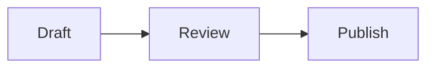

# md-editor-v3

Edit this document to explore Markdown rendering with locally installed dependencies.

## Task list

- [x] Write a heading

* [ ] Add a table

- [ ] Review the article

## Code

```javascript
const greeting = 'Hello, Markdown';
```

An explicitly named custom language can be displayed as literal text when no grammar is registered:

```custom-language
<message>Hello, Markdown</message>
```

## Table

| Component | Purpose           |
| --------- | ----------------- |
| MdEditor  | Edit Markdown     |
| MdPreview | Render an article |
| MdCatalog | Navigate headings |

## Formula

Inline math: $E = mc^2$.

$$
\sum_{i=1}^{n} i = \frac{n(n+1)}{2}
$$

## Diagram



## Chart

```echarts
{
  xAxis: { type: 'category', data: ['Draft', 'Review', 'Published'] },
  yAxis: { type: 'value' },
  series: [{ type: 'bar', data: [3, 2, 5] }]
}
```
